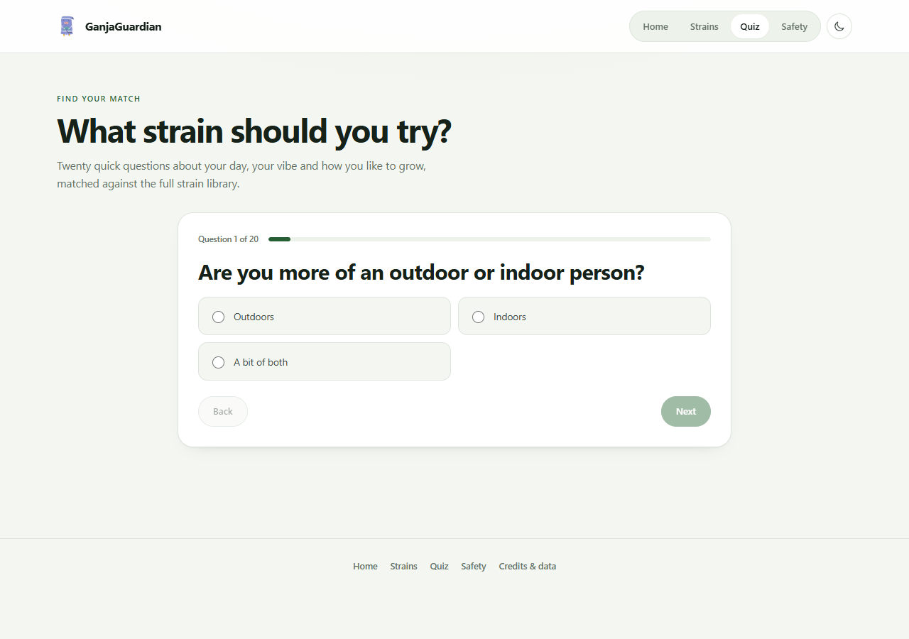

# GanjaGuardian

I made GanjaGuardian because most strain sites feel like a shop first and a guide second. This one is a clean place to look up strains, look at flower photos, and compare what people report.

Inside of "Releases" you can find the APK version + the Windows if you're interested in this project more :) 

## What is inside

* 12,019 strain profiles, including Stardawg and other commonly searched regional names
* search that treats `Stardawg`, `Star Dawg`, `AK47` and `AK-47` as the same kind of query
* an 18+ age gate before the site opens
* search that starts predicting from the first letter
* filters for Indica, Sativa and Hybrid
* licensed photos where available, otherwise a clean no verified image panel, not a repeated bud photo
* a photo browser with previous and next buttons
* a compare table for up to 3 strains
* a 20 question "What strain should you try?" quiz
* Gim's Top 3 owner picks: Donkey Butter, Pineapple Express and Blueberry Kush
* a full Safety To the Arts page with sprayed and PGR flower checks, pesticides, synthetic cannabinoids, weight additives and quality checks
* light and dark mode
* works from a folder on your computer

## Screenshots

## Run it

Open `index.html` in a browser. All pages and images are local. Nothing needs installing.

## Put it on GitHub Pages

1. Make a new repository on GitHub.
2. Upload everything inside this `Github` folder.
3. Open the repository settings and click Pages.
4. Under Build and deployment, choose Deploy from a branch.
5. Choose `main` and `/ (root)`, then save.
6. Wait a minute and GitHub will give you the link.

## Files

* `index.html` is the homepage.
* `strains.html` is the full library.
* `strain.html` is the profile page.
* `quiz.html` is the 20 question strain quiz.
* `safety.html` is the full Safety To the Arts page.
* `credits.html` has all photo credits.
* `assets/` has the CSS, JavaScript and photos.
* `icons/` has the original PFP image.
* `.nojekyll` tells GitHub Pages to serve the files as they are.

## Photos and data

The core profiles have hand written copy and use local licensed photos where a photo is available. A profile only shows a bud photo when a licensed strain specific photo is available. Profiles without one use a clean no verified image panel, not a repeated stock image.

I do not have a licensed source for 12,019 strain specific photos. I will not call a stock bud photo a real photo of a random strain. The photo library is split into `assets/images/Photos1` to `Photos8`, with a maximum of 99 files in each folder. `Photos1` holds the 23 openly licensed photos currently used by the site. `Photos2` to `Photos8` are ready for licensed strain photos named by slug. A licensed photo can be wired in through `assets/js/verified-photos.js`.

The full searchable library includes 12,019 unique names. The 12,007 extra records were selected from the Cannabis Intelligence Database by Shannon Goddard for reported stats, and a 779 name recognition list was used as a curation check. Keeping the full catalog means Stardawg and other commonly searched names are not missed. No Leafly descriptions or images are copied. The extra records are used under CC BY 4.0. Full photo credits are on `credits.html`.

Potency numbers are reference examples, not lab results. Effects and flavours are commonly reported info. Cannabis laws are different everywhere, so check your local rules.

## Roadmap

* a licensed source for real strain photos
* more strain specific photos
* favourites
* a simple grow log

The code is intentionally simple so the site can stay fast, readable and easy to publish.
