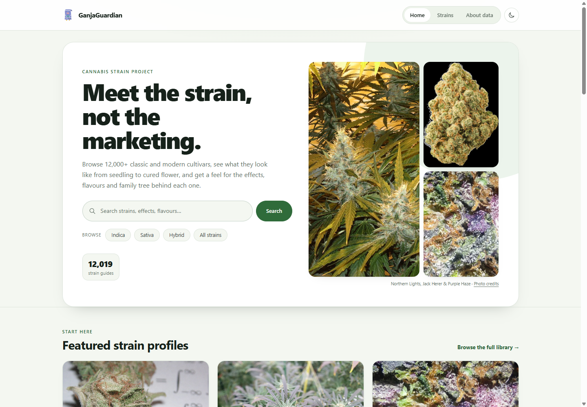
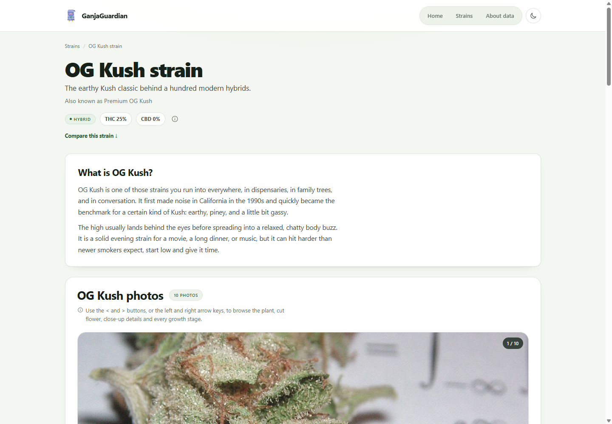
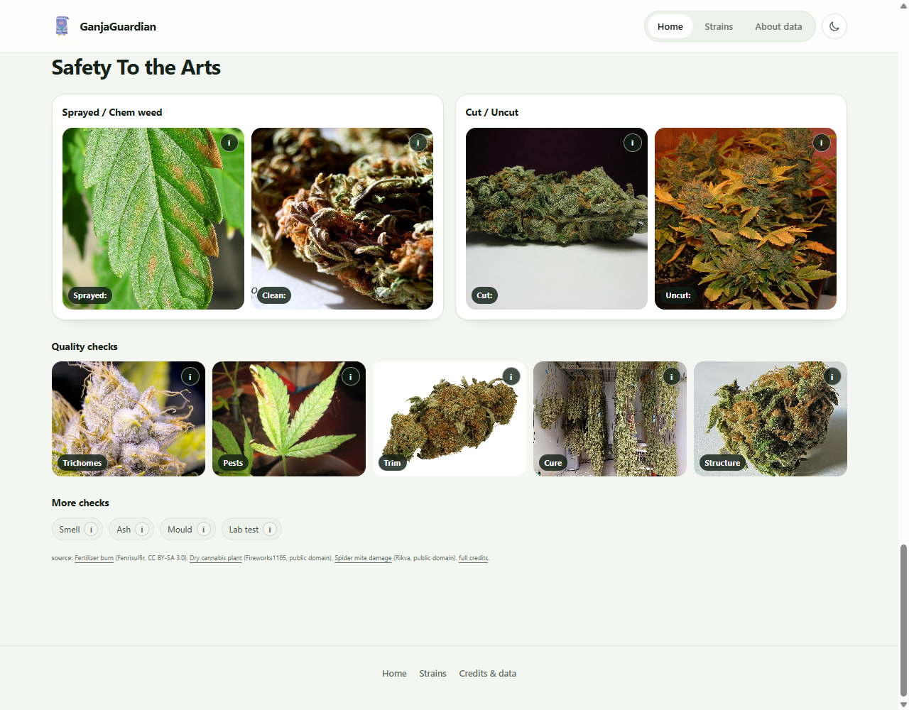
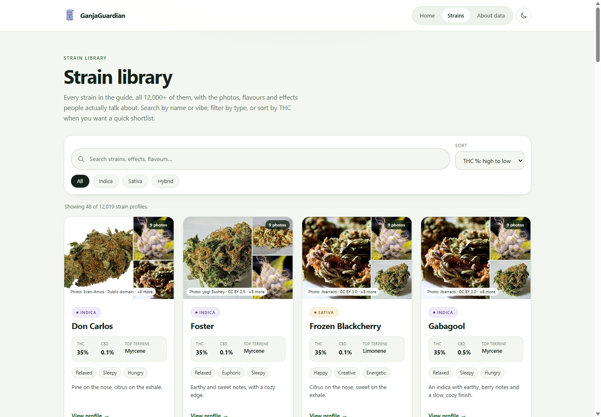
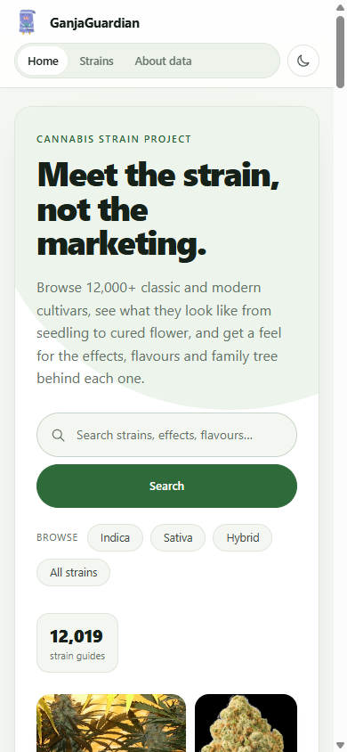

# GanjaGuardian

I made GanjaGuardian because most strain sites feel like a shop first and a guide second. This one is just a clean place to look up strains, see real flower photos, and compare what people report.

It is a static site. No account, no server, no build step.

## What is inside

* 12,019 strain profiles
* search that starts predicting from the first letter
* filters for Indica, Sativa and Hybrid
* profiles with photos, effects, flavours, terpenes, genetics and grow notes
* a photo browser with previous and next buttons
* a compare table for up to 3 strains
* a Safety To the Arts section with sprayed flower, cut and uncut photos and quality checks
* light and dark mode
* works from a folder on your computer

## Screenshots

## Run it

Open `index.html` in a browser. All pages and images are local. Nothing needs installing.

## Put it on GitHub Pages

1. Make a new repository on GitHub.
2. Upload everything inside this `Github` folder.
3. Open the repository settings and click Pages.
4. Under Build and deployment, choose Deploy from a branch.
5. Choose `main` and `/ (root)`, then save.
6. Wait a minute and GitHub will give you the link.

## Files

* `index.html` is the homepage.
* `strains.html` is the full library.
* `strain.html` is the profile page.
* `credits.html` has all photo credits.
* `assets/` has the CSS, JavaScript and photos.
* `icons/` has the original PFP image.
* `.nojekyll` tells GitHub Pages to serve the files as they are.

## Photo and data notes

The expanded strain records come from the Cannabis Intelligence Database by Shannon Goddard and are used under CC BY 4.0. Full photo credits are on `credits.html`.

Photos come from Wikimedia Commons under CC BY, CC BY-SA, CC0 or public domain. A picture is attached to a strain only when the original file is named as that cultivar. Other profiles use real cannabis photos of the same grow stage and label them representative. There is not an openly licensed photo of every cultivar.

Potency numbers are reference examples, not lab results. Effects and flavours are commonly reported info. Cannabis laws are different everywhere, so check your local rules.

## Stuff I still want to add

* better filters
* a favourites list
* maybe a simple grow log

I am still learning, so the code is simple on purpose. If something looks off, open an issue or send a fix.
